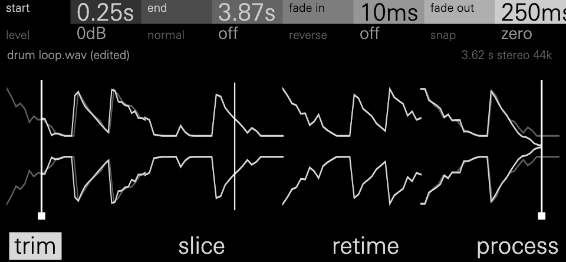

# OP-XY Sample Studio



A sample editor inside the OP-XY's sample library. Trim, slice, retime and
process a sample, hear each change on the keys as you turn, then save the
result as a new file beside the original, as slices, or as a new drum kit.

It is a firmware extension for the teenage engineering OP-XY, built with the
community [Open-XY SDK](https://github.com/etcetc000/open-xy).

**Status: experimental.** Played on an OP-XY running OS 1.2.1. CPU measured on
the device. Needs an SDK build with Sample Studio in it: see
[Installing](#installing).

## Opening it

Press Shift + Sample to open the library and highlight a sample.

- On a sampler track, press M1 (`edit`).
- On a drum sampler or multisampler track, hold Shift: `edit` appears over M1.
  Shift + M1 opens the highlighted sample for the selected key.
- On any other track, M1 opens the highlighted file.

Sample closes the studio. With an unsaved edit, a card asks first.

## Pages

M1 to M4 choose the page. Each page has two rows of four controls; press an
encoder to switch rows. Hold Shift and M1 to M4 become undo, compare (the
original), play (the edit) and save.

While the studio is open, the track's keys and the sequencer play the edit at
the key's own level, and stop when you let go. Every change is heard at once,
except beat-mode retime, which renders first and plays what's ready as it goes.

### Trim

| Control | Range | Does |
| --- | --- | --- |
| start, end | the sample's length | The markers. Press an encoder on either to zoom in on it |
| fade in, fade out | 0 to 2 s | Fades at the markers |
| level | -30 to +20 dB | The edit's level |
| normal | off, 0, -1, -3, -6 dB | Normalises the peak between the markers instead of level |
| reverse | off, on | Plays the edit backwards. The waveform flips so the playhead still runs left to right |
| snap | off, zero | Moves the markers to the nearest zero crossing |

### Slice

| Control | Range | Does |
| --- | --- | --- |
| slices | 2 to 24 | How many slices |
| mode | even, trans | Equal slices, or slices at the strongest transients |
| sens | 0 to 100 | How readily `trans` finds a transient |
| slice | all, 1 to 24 | The slice that play and Shift + M3 audition |
| fade | 0 to 50 ms | A fade at both ends of every slice |
| snap | off, zero | Moves the cuts to zero crossings |

On the slice page the track's first key plays slice 1, the next slice 2, and so on.

### Retime

| Control | Range | Does |
| --- | --- | --- |
| speed | x0.25 to x4 | Playback speed. Faster is shorter |
| pitch | -24 to +24 st | In tape mode, the pitch that comes with the speed. In beat mode, a separate pitch shift |
| mode | tape, beat | Tape changes speed and pitch together, live. Beat keeps the pitch and renders first |
| fit | off, 1, 2, 4, 8 bars | Sets the speed so the edit lasts that many bars at the project's tempo |
| grain | 20 to 120 ms | Beat mode's grain size |

### Process

| Control | Range | Does |
| --- | --- | --- |
| rate | off, 32k down to 2k | Sample-rate reduction |
| bits | off, 12 down to 2 bit | Bit depth |
| drive | 0 to 100% | Soft saturation |
| filter | -50 to -12k, off, +50 to +12k | One sweep: low-pass to the left, high-pass to the right |
| fx i, fx ii | 0 to 100% | Sends into whatever effects sit on FX I and FX II, at the track send's curve |
| tail | 0 to 10 s, full | How long a save records the effects ringing out |
| comp | 0 to 100% | Compression: threshold and ratio together |

## Saving

Shift + M4 saves. The original is never changed.

- **Save** writes `name-ed1.wav` beside the original and puts it on the key,
  with undo (Shift + M1 brings the key's own sample back). Factory samples save
  to `samples/user`. Files up to about 90 seconds save whole; a key plays the
  first 20 seconds, as stock does.
- **Save slices**, on the slice page, writes one file per slice. A card offers
  where they go: files only, a new drum kit preset in `presets/snapshot` (its
  slices on the keys from the first up), or, on a drum track, this kit's keys from the
  selected one up.
- **With fx i or fx ii above 0**, the save records the edit through the real
  effects in real time, with `tail` seconds after it. `full` records until the
  effects have died away (under -60 dB for 2 seconds), at most 30 seconds; if
  they are still ringing then, the card says so. Slices record the whole edit
  first, then cut it, so each slice carries the ring of the one before and the
  last carries the tail. Stop the sequencer first: other tracks feed the same
  effects. A beat-mode retime records through its finished render, up to 20
  seconds long; a longer one saves dry.
- New files and kits show in the library and the preset browser as soon as the
  studio closes.

## Limits

- The studio holds the selected track's voices while it is open. The track
  sounds again when it closes.
- Keys play up to 20 seconds of a sample, as stock does. Saves write up to
  about 90 seconds.
- 8-bit, 24-bit and AIFF samples open through stock's own decoding.
- It can't share a firmware with a master-bus extension such as a DJ filter.
- A firmware with Sample Studio also needs a sample engine, or Drumline page 2,
  among its machines.

## CPU

Measured on the device (OS 1.2.1) from 411 plays, as a share of the audio
board's time per block, while the studio plays:

| Edit | Average | Worst block |
| --- | --- | --- |
| Trim only | 3.6% | 5.0% |
| A whole session, mixed settings (36 plays) | 3.8% | 7.0% |
| Heaviest seen: tape retime x1.75, rate, bits, drive, filter, comp and both sends | 12.4% | 14.5% |

Nothing runs while the studio is closed. Renders and saves run on the main
board, not the audio board.

## Installing

Sample Studio needs firmware built with an SDK that has Sample Studio in it.
No firmware is published here: you build your own from your own OP-XY's OS.
[docs/install.md](docs/install.md) covers it step by step: copying the OS from
your OP-XY, building, copying the build over, writing the OS, and going back to
stock.

The extension is the `sample_studio/` folder. It holds only its record; the
editor itself is the SDK's.

## Develop

The screens above are drawn by the studio's own code: `tools/screens` builds it
in a Linux container with stock calls stubbed, sets each scene, and renders the
frames in the OP-XY's screen font.

```sh
tools/screens/run.sh <open-xy checkout with Sample Studio> out
XY_FONT=<UniversNextPro-Light.ttf> python3 tools/screens/render.py <open-xy checkout> out
```

## Licence

MIT. See [LICENSE](LICENSE).
